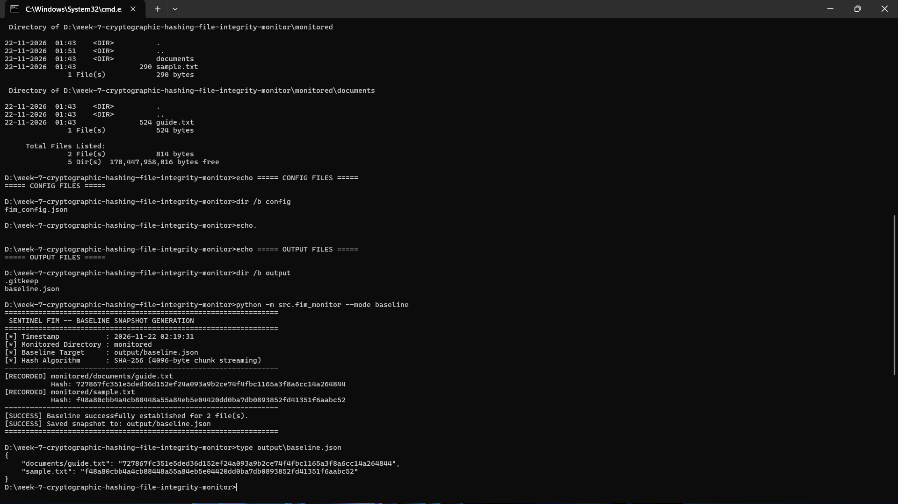
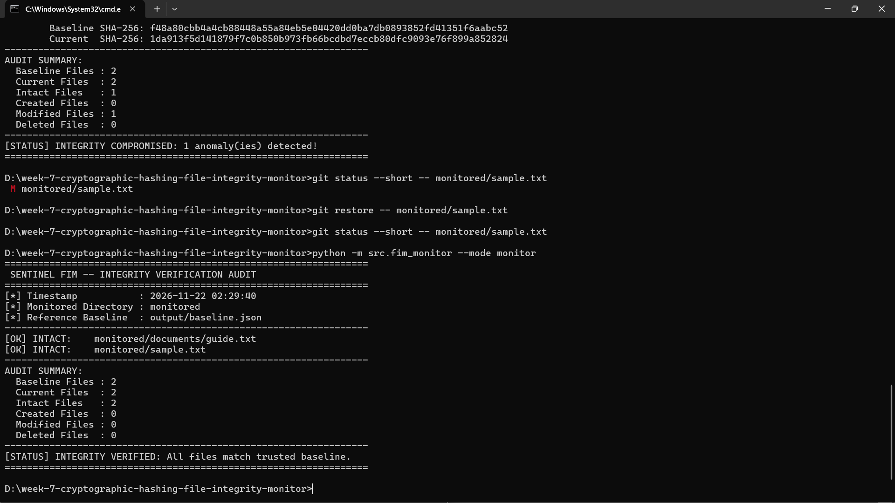
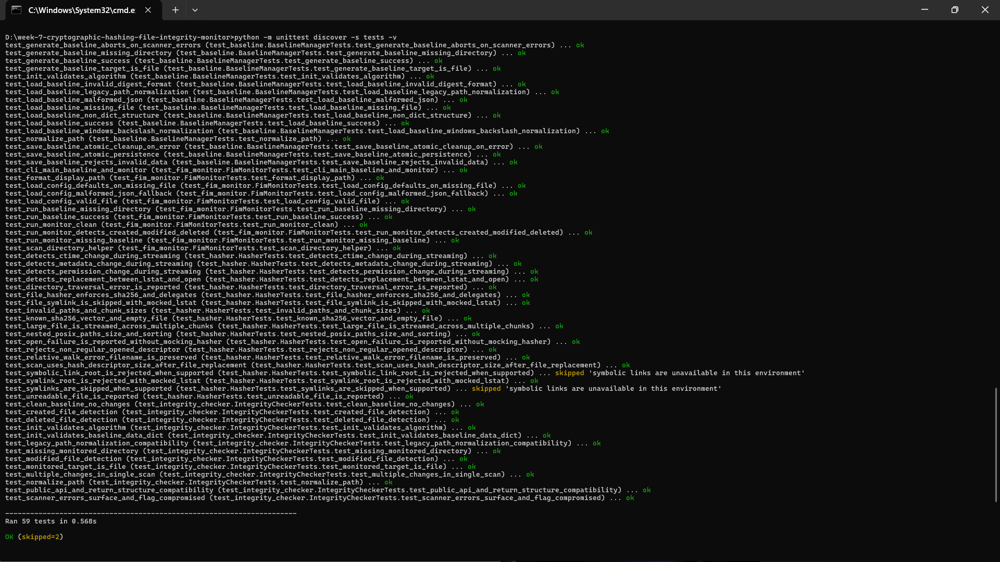

# Sentinel FIM — Cryptographic File Integrity Monitor

[](https://www.python.org/)
[-success.svg)](https://csrc.nist.gov/publications/detail/fips/180-4/final)
[]()
[]()

A modular, on-demand File Integrity Monitoring (FIM) tool implemented in Python. Sentinel FIM establishes cryptographic baselines using streaming SHA-256 digests, performs differential integrity auditing against target directories, and flags unauthorized file modifications, newly created assets, and deleted files.

---

## Table of Contents

- [1. Project Overview & Objectives](#1-project-overview--objectives)
- [2. Key Features](#2-key-features)
- [3. Cryptographic Security & Approach](#3-cryptographic-security--approach)
  - [3.1 SHA-256 Fundamentals](#31-sha-256-fundamentals)
  - [3.2 Collision Resistance: SHA-256 vs. MD5 and SHA-1](#32-collision-resistance-sha-256-vs-md5-and-sha-1)
  - [3.3 Pre-Image and Second Pre-Image Resistance](#33-pre-image-and-second-pre-image-resistance)
  - [3.4 The Cryptographic Avalanche Effect](#34-the-cryptographic-avalanche-effect)
  - [3.5 Cryptographic Boundaries & Limitations](#35-cryptographic-boundaries--limitations)
- [4. Project Architecture & Repository Structure](#4-project-architecture--repository-structure)
  - [4.1 Repository Layout](#41-repository-layout)
  - [4.2 Component Responsibilities](#42-component-responsibilities)
- [5. Security Safeguards & Design Decisions](#5-security-safeguards--design-decisions)
- [6. Configuration](#6-configuration)
- [7. Installation & Setup](#7-installation--setup)
- [8. Usage Guide](#8-usage-guide)
  - [8.1 Baseline Mode](#81-baseline-mode)
  - [8.2 Monitor Mode](#82-monitor-mode)
  - [8.3 Exit Code Semantics](#83-exit-code-semantics)
- [9. Tampering Demonstration & Audit Workflow](#9-tampering-demonstration--audit-workflow)
- [10. Screenshots & Demonstration](#10-screenshots--demonstration)
- [11. Automated Testing & Verification](#11-automated-testing--verification)
- [12. Operational Limitations & Security Considerations](#12-operational-limitations--security-considerations)
- [13. Future Enhancements](#13-future-enhancements)

---

## 1. Project Overview & Objectives

In cybersecurity operations, unauthorized changes to system binaries, configurations, or operational assets often serve as primary indicators of compromise (IoC). Adversaries, web shells, and unauthorized processes routinely modify source files, inject persistence mechanisms, or remove audit logs.

**Sentinel FIM** addresses this problem by providing structured, on-demand differential integrity auditing:

1. **Cryptographic State Capture**: Scans a designated directory tree, computes deterministic SHA-256 digests in memory-bounded binary streams, and records the trusted state in an isolated JSON baseline database.
2. **On-Demand Differential Auditing**: Re-evaluates target files on demand against the trusted snapshot, classifying changes into **`[OK] INTACT`**, **`[ALERT] MODIFIED`**, **`[ALERT] CREATED`**, or **`[ALERT] DELETED`**.
3. **Defensive Filesystem Handling**: Implements descriptor-bound hashing, metadata stability checks, path traversal boundaries, and symlink refusal to mitigate race conditions during inspection.
4. **Standardized Status Signaling**: Returns deterministic exit codes (`0` for verified clean, `1` for compromised state or operational error) to support execution from administrative scripts or automation workflows.

> [!NOTE]
> Sentinel FIM operates as an **on-demand differential audit scanner**, not a continuous background filesystem monitoring daemon (such as kernel-level inotify or ReadDirectoryChangesW services). Integrity checks occur when explicitly invoked.

---

## 2. Key Features

- **Standard Library Implementation**: Built exclusively on Python's standard library (`hashlib`, `os`, `stat`, `pathlib`, `json`, `argparse`). Zero third-party dependencies.
- **Memory-Bounded 1 MiB Streaming**: Files are processed using a default buffer of 1 MiB (1,048,576 bytes), preventing memory exhaustion when hashing large files.
- **Descriptor-Bound TOCTOU Mitigation**: Hashing is performed directly on low-level file descriptors (`os.open` with `O_RDONLY | O_NOFOLLOW` and `os.fstat`) to reduce common Time-Of-Check to Time-Of-Use race windows.
- **Atomic Baseline Persistence**: Baselines are serialized to a temporary file, flushed and synced (`os.fsync`), and atomically swapped (`os.replace`) to prevent corrupted records if interrupted.
- **Scan Error Surfacing**: Filesystem permission errors, missing resources, or unreadable assets during an audit prevent false-clean reporting and mark the system state as compromised.
- **POSIX Path Normalization**: Cross-platform forward-slash path normalization prevents false anomalies caused by operating system separator differences (Windows backslashes vs. POSIX forward slashes).

---

## 3. Cryptographic Security & Approach

### 3.1 SHA-256 Fundamentals

Sentinel FIM uses **SHA-256 (Secure Hash Algorithm 256-bit)**, specified in NIST FIPS 180-4 (Secure Hash Standard). SHA-256 is an iterated cryptographic hash function based on the Merkle–Damgård construction, operating on 512-bit message blocks and producing a fixed 256-bit (32-byte) digest, typically formatted as a 64-character lowercase hexadecimal string.

### 3.2 Collision Resistance: SHA-256 vs. MD5 and SHA-1

A cryptographic hash function possesses *collision resistance* if finding any two distinct inputs $x \neq y$ such that $H(x) = H(y)$ is computationally infeasible.

| Metric / Property | MD5 (128-bit) | SHA-1 (160-bit) | SHA-256 (256-bit) |
| :--- | :--- | :--- | :--- |
| **Output Digest Size** | 128 bits (16 bytes) | 160 bits (20 bytes) | 256 bits (32 bytes) |
| **Theoretical Collision Workfactor** | $2^{64}$ operations (Birthday bound) | $2^{80}$ operations (Birthday bound) | $2^{128}$ operations (Birthday bound) |
| **Practical Security Status** | **Completely Broken** | **Cryptographically Broken** | **Secure / Recommended** |
| **Demonstrated Attacks** | Practical collisions (Wang et al., 2004); collision generation in seconds on commodity hardware. | Identical PDF collision (SHAttered, 2017 in $2^{63.1}$ ops); chosen-prefix collisions (2020). | No known collision or chosen-prefix collision attacks. |
| **FIM Suitability** | **Unacceptable**: Attackers can construct distinct files with identical MD5 digests. | **Unacceptable**: Practical collisions undermine trust in baseline records. | **Standard**: $2^{128}$ collision resistance workfactor exceeds classical computational limits. |

### 3.3 Pre-Image and Second Pre-Image Resistance

In File Integrity Monitoring, collision resistance is necessary, but **pre-image** and **second pre-image resistance** are the primary defenses against targeted tampering:

1. **Pre-Image Resistance (One-Way Property)**: Given a digest $h$, it must be computationally infeasible to find any input $m$ such that $H(m) = h$. SHA-256 provides approximately $2^{256}$ operations of pre-image security.
2. **Second Pre-Image Resistance**: Given a specific file $m_1$, it must be computationally infeasible to find a distinct file $m_2 \neq m_1$ such that $H(m_1) = H(m_2)$.

**Relevance to FIM**:
If an attacker modifies a file monitored by Sentinel FIM, defeating the monitor requires finding a *second pre-image*—crafting altered file content that produces the identical SHA-256 digest recorded in `baseline.json`. Because SHA-256 provides approximately 256 bits of second pre-image security ($2^{256}$ operations), forging an altered file that matches the baseline hash is computationally infeasible with classical computing systems.

> [!CAUTION]
> **Important Cryptographic Distinction**:
> Collision resistance ($H(x) = H(y)$ for *any* freely chosen pair) is bounded by the Birthday Paradox to $2^{128}$ operations for SHA-256. Second pre-image resistance ($H(m_2) = H(m_1)$ for a *fixed* target $m_1$) requires the full $2^{256}$ operations. Collision attacks do not directly equate to pre-image attacks.

### 3.4 The Cryptographic Avalanche Effect

SHA-256 exhibits a strict avalanche effect: altering a single bit or character in an input file produces an uncorrelated, pseudo-random change across approximately 50% of the output digest bits.

**Demonstrated Behavior on `monitored/sample.txt`**:
- **Baseline State**:
  - File Content ending: `Clean / Unmodified.`
  - SHA-256: `f48a80cbb4a4cb88448a55a84eb5e04420dd0ba7db0893852fd41351f6aabc52`
- **1-Character Modification**:
  - File Content ending: `Clean / Xnmodified.` (altered single character `U` $\to$ `X`)
  - SHA-256: `83bc51ff1476f0b684125e163ef0cde975df69dc99167e0798a657ed30d0f5d6`

The modification of a single byte altered 60 of the 64 hexadecimal characters, triggering an immediate integrity alert during the audit pass.

### 3.5 Cryptographic Boundaries & Limitations

While SHA-256 reliably detects content alterations, cryptographic hashing alone has defined operational boundaries:
- **Hashing does not prevent tampering**: A hash function detects changes retrospectively when audited; it does not stop an attacker or process from modifying files on disk.
- **Hashing does not authenticate the baseline file**: If an adversary possesses write access to `output/baseline.json`, they could regenerate or edit baseline digests to match tampered files. Baseline integrity relies on filesystem permissions or external storage protections.
- **Content hashing vs. Metadata**: The SHA-256 digest represents file content. While the hashing engine verifies metadata consistency during reading to detect concurrent writes, the baseline comparison evaluates content hashes and path existence, not filesystem timestamps or ACL changes.

---

## 4. Project Architecture & Repository Structure

### 4.1 Repository Layout

```text
week-7-cryptographic-hashing-file-integrity-monitor/
├── config/
│   └── fim_config.json                 # Operational configuration (paths & algorithm)
├── monitored/                          # Target directory for sample integrity auditing
│   ├── documents/
│   │   └── guide.txt                   # Sample nested document
│   └── sample.txt                      # Sample root document
├── output/                             # Isolated baseline storage directory
│   ├── .gitkeep
│   └── baseline.json                   # Trusted cryptographic baseline database
├── screenshots/                        # Demonstration and verification artifacts
│   ├── .gitkeep
│   ├── 01-project-structure.png        # Screenshot: Repository and directory verification
│   ├── 02-baseline-generation.png      # Screenshot: Baseline generation execution
│   ├── 03-clean-integrity-check.png    # Screenshot: Clean verification pass
│   ├── 04-tampering-detection.png      # Screenshot: Tamper detection alert
│   ├── 05-restored-integrity.png       # Screenshot: Post-restoration verification
│   └── 06-unit-test-results.png        # Screenshot: Unit test suite execution
├── src/
│   ├── __init__.py                     # Package export declarations
│   ├── baseline.py                     # BaselineManager: atomic persistence & validation
│   ├── fim_monitor.py                  # Primary CLI entrypoint, argument parsing, & reporting
│   ├── hasher.py                       # Hardened descriptor-bound SHA-256 streaming scanner
│   └── integrity_checker.py            # IntegrityChecker: differential analysis & alert logic
├── tests/
│   ├── __init__.py
│   ├── test_baseline.py                # 16 tests: generation, atomic save, schema validation
│   ├── test_fim_monitor.py             # 11 tests: CLI args, config parsing, exit codes
│   ├── test_hasher.py                  # 19 tests: streaming, TOCTOU stability, symlink checks
│   └── test_integrity_checker.py       # 13 tests: differential matching, error surfacing
├── .gitignore                          # Excludes .venv/, .dist/, __pycache__/, .env
├── PHASE_0_AUDIT_REPORT.md             # Initial project audit record
├── PHASE_1_FINAL_SECURITY_REVIEW.md    # Security review record
├── PHASE_1_REMEDIATION_REPORT.md       # Implementation remediation record
├── PHASE_2_1_REPORT.md                 # Baseline refactoring verification report
├── PHASE_2_2_REPORT.md                 # Integrity checker refactoring verification report
├── PHASE_2_ARCHITECTURE_PLAN.md        # Modular architecture design plan
├── README.md                           # Technical documentation & project portfolio
└── requirements.txt                    # Dependency declaration (Standard library only)
```

### 4.2 Component Responsibilities

```
                                 CLI Entrypoint
                          (python -m src.fim_monitor)
                                       │
                      ┌────────────────┴────────────────┐
                      ▼                                 ▼
              [--mode baseline]                 [--mode monitor]
                      │                                 │
                      ▼                                 ▼
             src/baseline.py                 src/integrity_checker.py
            (BaselineManager)                   (IntegrityChecker)
              - Schema check                      - Differential diff
              - Atomic persistence                - Anomaly categorization
                      │                                 │
                      └────────────────┬────────────────┘
                                       │
                                       ▼
                                 src/hasher.py
                               (scan_directory)
                        - Descriptor-bound streaming
                        - 1 MiB chunked SHA-256
                        - TOCTOU metadata checks
                        - Symlink / non-regular skip
```

- **`src/hasher.py`**: The authoritative scanning and hashing engine. Implements `scan_directory()` and `calculate_sha256()`. Opens files using `os.open` with `O_RDONLY | O_NOFOLLOW`, inspects file descriptors with `os.fstat`, verifies metadata consistency before and after stream hashing, and returns structured `ScanResult` instances containing file digests, sizes, and aggregated errors.
- **`src/baseline.py`**: Houses `BaselineManager`. Validates target directories, enforces SHA-256 hex format validation (`^[0-9a-f]{64}$`), normalizes relative paths, and handles atomic disk persistence via temporary files and `os.replace()`.
- **`src/integrity_checker.py`**: Houses `IntegrityChecker`. Consumes baseline mappings and live `ScanResult` states to compute differential sets (`intact`, `created`, `modified`, `deleted`, `errors`). Guarantees that any scanning error prevents a false-clean verification.
- **`src/fim_monitor.py`**: The primary CLI orchestration interface. Handles command-line arguments, validates JSON configuration, formats human-readable terminal alerts, and maps audit outcomes to process exit codes.

---

## 5. Security Safeguards & Design Decisions

The implementation incorporates several defensive programming measures:

1. **Memory-Bounded Hashing (1 MiB Buffer)**:
   In `src/hasher.py`, hashing is performed via streaming chunks (`DEFAULT_CHUNK_SIZE = 1024 * 1024`, 1 MiB). Files of arbitrary size can be hashed without loading entire payloads into memory.
2. **Descriptor-Bound Inspection**:
   Files are opened once via `os.open` using `O_RDONLY` (and `O_BINARY` on Windows; `O_NOFOLLOW` where available). Subsequent inspections (`os.fstat`) and stream reads operate on the opened descriptor rather than re-resolving filesystem paths, narrowing common TOCTOU race windows.
3. **File Stability Verification**:
   The engine captures file metadata (`st_dev`, `st_ino`, `st_mode`, `st_size`, `st_mtime_ns`) prior to opening, on descriptor access, and after stream completion. If a file's identity, size, or modification metadata changes during the read, hashing raises `FileStabilityError` and treats the read as inconclusive.
4. **Symbolic Link & Root Escape Rejection**:
   Symlinks are not traversed (`followlinks=False`). If a symlink directory or file is encountered, it is recorded as an error and skipped. All resolved candidate paths must verify containment within the monitored root (`resolved_candidate.relative_to(resolved_root)`).
5. **Atomic Baseline Persistence**:
   `BaselineManager.save_baseline()` writes to `output/baseline.json.tmp.<pid>`, issues `os.fsync()` to force disk flush, and swaps the file using `os.replace()`. An abrupt termination or system failure will not corrupt an existing baseline.
6. **Scan Error Surfacing**:
   If unreadable files or directory permission errors occur during an audit pass, `IntegrityChecker` surfaces them in the audit summary and flags `is_compromised = True`. An incomplete or blind scan cannot return a false clean state.
7. **Storage Isolation**:
   `baseline.json` is located in `output/`, strictly outside `monitored/`, preventing recursive self-hashing loops and inadvertent baseline tampering.

---

## 6. Configuration

Sentinel FIM is configured through `config/fim_config.json`:

```json
{
  "algorithm": "sha256",
  "monitored_directory": "monitored",
  "baseline_file": "output/baseline.json"
}
```

### Configuration Parameters:
- **`algorithm`**: Hash algorithm to utilize. Fixed to `"sha256"` (other algorithms raise `ValueError`).
- **`monitored_directory`**: Target directory audited during baseline generation and monitoring passes.
- **`baseline_file`**: Relative or absolute path where the baseline snapshot database is stored.

CLI arguments override configuration file values when supplied.

---

## 7. Installation & Setup

### Prerequisites
- Python 3.10 or higher.
- Git.
- Windows, Linux, or macOS.

### Clone the Repository
```bash
git clone https://github.com/injmam089/week-7-cryptographic-hashing-file-integrity-monitor.git
cd week-7-cryptographic-hashing-file-integrity-monitor
```

### Environment Setup (Optional Virtual Environment)
Sentinel FIM requires only the Python standard library. A virtual environment can optionally be established:

```bash
# Windows
python -m venv .venv
.venv\Scripts\activate

# Linux / macOS
python3 -m venv .venv
source .venv/bin/activate
```

Verify the environment:
```bash
python -V
```

---

## 8. Usage Guide

Invoke Sentinel FIM using Python module execution syntax:

```bash
python -m src.fim_monitor --mode <baseline|monitor> [OPTIONS]
```

### Verified CLI Options:
| Flag | Type | Description | Default |
| :--- | :---: | :--- | :--- |
| **`--mode`** | String | Execution mode: `baseline` or `monitor`. *(Required)* | N/A |
| **`--dir`** | Path | Target directory to monitor. | Value from `fim_config.json` (`monitored`) |
| **`--baseline`** | Path | Destination/source baseline JSON file. | Value from `fim_config.json` (`output/baseline.json`) |
| **`--config`** | Path | Path to custom configuration file. | `config/fim_config.json` |

---

### 8.1 Baseline Mode

Generates a fresh cryptographic snapshot of all regular files within the target folder and writes the baseline database:

```bash
python -m src.fim_monitor --mode baseline
```

#### Execution Details:
1. Validates the existence of the target directory.
2. Traverses regular files and computes SHA-256 digests in 1 MiB stream buffers.
3. Validates digest formatting and schema.
4. Atomically saves records to `output/baseline.json`.

#### Example Console Output:
```text
=================================================================
 SENTINEL FIM -- BASELINE SNAPSHOT GENERATION
=================================================================
[*] Timestamp           : 2026-11-22 02:19:31
[*] Monitored Directory : monitored
[*] Baseline Target     : output/baseline.json
[*] Hash Algorithm      : SHA-256 (4096-byte chunk streaming)
-----------------------------------------------------------------
[RECORDED] monitored/documents/guide.txt
           Hash: 727867fc351e5ded36d152ef24a093a9b2ce74f4fbc1165a3f8a6cc14a264844
[RECORDED] monitored/sample.txt
           Hash: f48a80cbb4a4cb88448a55a84eb5e04420dd0ba7db0893852fd41351f6aabc52
-----------------------------------------------------------------
[SUCCESS] Baseline successfully established for 2 file(s).
[SUCCESS] Saved snapshot to: output/baseline.json
=================================================================
```

> [!NOTE]
> *Implementation Note on Console Output*: The CLI banner string displays `(4096-byte chunk streaming)` as an output label, while the underlying cryptographic engine in `src/hasher.py` buffers and streams binary data in 1 MiB blocks (`DEFAULT_CHUNK_SIZE = 1024 * 1024`).

---

### 8.2 Monitor Mode

Performs an on-demand differential verification audit comparing current filesystem contents to `output/baseline.json`:

```bash
python -m src.fim_monitor --mode monitor
```

#### Clean State Output (All Files Intact):
```text
=================================================================
 SENTINEL FIM -- INTEGRITY VERIFICATION AUDIT
=================================================================
[*] Timestamp           : 2026-11-22 02:29:40
[*] Monitored Directory : monitored
[*] Reference Baseline  : output/baseline.json
-----------------------------------------------------------------
[OK] INTACT:    monitored/documents/guide.txt
[OK] INTACT:    monitored/sample.txt
-----------------------------------------------------------------
AUDIT SUMMARY:
  Baseline Files : 2
  Current Files  : 2
  Intact Files   : 2
  Created Files  : 0
  Modified Files : 0
  Deleted Files  : 0
-----------------------------------------------------------------
[STATUS] INTEGRITY VERIFIED: All files match trusted baseline.
=================================================================
```

#### Compromised State Output (Tampered File Detected):
```text
=================================================================
 SENTINEL FIM -- INTEGRITY VERIFICATION AUDIT
=================================================================
[*] Timestamp           : 2026-11-22 02:25:52
[*] Monitored Directory : monitored
[*] Reference Baseline  : output/baseline.json
-----------------------------------------------------------------
[ALERT] MODIFIED: monitored/sample.txt
        Baseline SHA-256: f48a80cbb4a4cb88448a55a84eb5e04420dd0ba7db0893852fd41351f6aabc52
        Current  SHA-256: 1da913f5d141879f7c0b850b973fb66bcdbd7eccb80dfc9093e76f899a852824
-----------------------------------------------------------------
AUDIT SUMMARY:
  Baseline Files : 2
  Current Files  : 2
  Intact Files   : 1
  Created Files  : 0
  Modified Files : 1
  Deleted Files  : 0
-----------------------------------------------------------------
[STATUS] INTEGRITY COMPROMISED: 1 anomaly(ies) detected!
=================================================================
```

---

### 8.3 Exit Code Semantics

Sentinel FIM issues deterministic exit codes to communicate status:
- **`0` (Success / Clean)**:
  - Baseline mode: Baseline generated and persisted successfully.
  - Monitor mode: All monitored files match the baseline; zero anomalies and zero scan errors.
- **`1` (Integrity Breach or Operational Error)**:
  - Baseline mode: Monitored directory does not exist, or unreadable files blocked baseline generation.
  - Monitor mode: One or more anomalies detected (`CREATED`, `MODIFIED`, `DELETED`), unreadable scan errors encountered, or baseline file missing.

---

## 9. Tampering Demonstration & Audit Workflow

To verify Sentinel FIM's detection capabilities, an administrator can conduct an illustrative tampering test:

### Step 1: Establish Trusted Baseline
```bash
python -m src.fim_monitor --mode baseline
```

### Step 2: Verify Initial Clean State
```bash
python -m src.fim_monitor --mode monitor
```
*Expected: Exit code 0, all files flagged `[OK] INTACT`.*

### Step 3: Simulate Unauthorized Modification
Simulate an attacker appending unauthorized data to an existing monitored document:

```bash
# Windows Command Prompt
echo TAMPERING TEST - unauthorized modification >> monitored\sample.txt

# Linux / macOS
# echo "TAMPERING TEST - unauthorized modification" >> monitored/sample.txt
```

### Step 4: Execute Monitor Audit
```bash
python -m src.fim_monitor --mode monitor
```
*Result: Process reports `[ALERT] MODIFIED: monitored/sample.txt`, displaying both baseline and altered digests, and terminates with exit code 1.*

### Step 5: Restore Clean State
Restore the monitored file to match the baseline state:

```bash
# Using Git checkout/restore for sample file
git restore monitored/sample.txt

# Re-run audit pass
python -m src.fim_monitor --mode monitor
```
*Result: Integrity status returns to `[STATUS] INTEGRITY VERIFIED`, and process exits with code 0.*

> [!NOTE]
> **Multi-Anomaly Coverage**: In addition to single-file modifications demonstrated above, comprehensive multi-vector scenarios (simultaneous file additions, alterations, and removals) are verified programmatically in the test suite (`tests/test_fim_monitor.py` and `tests/test_integrity_checker.py`), ensuring that multiple concurrent anomalies are captured in a single audit pass.

---

## 10. Screenshots & Demonstration

The following visual records document repository setup, baseline establishment, anomaly detection, restoration, and automated test execution.

### 1. Project Structure & Environment Verification
Inspection of repository root, source directory (`src/`), and test suite (`tests/`).


---

### 2. Baseline Snapshot Generation
Execution of `python -m src.fim_monitor --mode baseline`, indexing initial sample files and saving `output/baseline.json`.


---

### 3. Clean Integrity Verification
Execution of `python -m src.fim_monitor --mode monitor` confirming that all monitored files match the baseline with zero anomalies.



---

### 4. Unauthorized Tampering Detection
Demonstration of an unauthorized modification to `monitored/sample.txt`, resulting in an immediate `[ALERT] MODIFIED` detection and compromised status exit.


---

### 5. Restored Integrity Verification
Reversion of the modified file using `git restore` and subsequent audit re-run, returning the system to `[STATUS] INTEGRITY VERIFIED`.



---

### 6. Automated Test Suite Execution
Complete execution of the project's 59 automated test cases across all modules with verbose output.



---

## 11. Automated Testing & Verification

Sentinel FIM maintains automated unit and integration tests across all four core modules.

### Running the Test Suite

Execute tests using the standard library `unittest` runner:

```bash
python -m unittest discover -s tests -v
```

### Verified Test Execution Results:
```text
Ran 59 tests in 0.568s

OK (skipped=2)
```

### Metrics Summary:
- **Total Tests Discovered**: 59
- **Passed**: 57
- **Skipped**: 2
- **Failed**: 0
- **Execution Time**: ~0.56s

### Reason for Skipped Tests:
Two tests in `tests/test_hasher.py` (`test_symbolic_link_root_is_rejected_when_supported` and `test_symlinks_are_skipped_when_supported`) evaluate symbolic-link rejection behavior. On Windows operating systems, creating filesystem symbolic links requires administrative elevation (`SeCreateSymbolicLinkPrivilege`) or Developer Mode. When tests run in a standard non-elevated user context, the test suite catches this limitation and marks the tests as `skipped 'symbolic links are unavailable in this environment'` rather than reporting a false failure.

### Test Coverage Breakdown:
| Test Module | Tests | Focus Area |
| :--- | :---: | :--- |
| **`tests/test_hasher.py`** | 19 | 1 MiB chunked streaming, descriptor lifecycle, TOCTOU metadata verification, non-regular file refusal, symlink skipping. |
| **`tests/test_baseline.py`** | 16 | Directory traversal, schema validation, 64-character hex regex enforcement, atomic temporary-file swap (`os.replace`). |
| **`tests/test_integrity_checker.py`** | 13 | Differential sets (`intact`, `created`, `modified`, `deleted`), path normalization parity, scan error surfacing. |
| **`tests/test_fim_monitor.py`** | 11 | CLI argument parsing, configuration fallback, exit code validation (`0` vs. `1`), end-to-end audit reporting. |

---

## 12. Operational Limitations & Security Considerations

When deploying or assessing Sentinel FIM, security analysts should consider the following operational characteristics:

1. **Baseline Database Trust Boundary**:
   The integrity of any FIM audit relies entirely on the integrity of the baseline reference database (`output/baseline.json`). If an adversary gains write access to `baseline.json`, they can overwrite baseline hashes with tampered file digests. In production environments, baseline records should be stored on write-once media (WORM), protected via operating system access control lists (ACLs), or cryptographically signed.
2. **On-Demand vs. Continuous Event Monitoring**:
   Sentinel FIM executes on demand. Changes that occur between scheduled audit runs remain undetected until the next execution pass. It does not replace real-time operating system kernel file system auditing (such as Linux `auditd` or Windows Sysmon FileCreate/FileDelete events).
3. **Metadata Audit Scope**:
   While `src/hasher.py` checks file metadata stability during stream hashing to prevent race conditions, the differential engine (`src/integrity_checker.py`) audits file existence and content digests. Benign metadata modifications (such as changes to `st_atime` or access permissions that do not alter content) are not recorded as content modifications.
4. **Symbolic Links**:
   To prevent symlink traversal attacks, directory escaping, and infinite recursion, Sentinel FIM treats symbolic links as non-regular files and skips them. Symbolic links should not be used as monitored root directories.

---

## 13. Future Enhancements

Potential extensions to augment Sentinel FIM for broader deployments:

1. **Cryptographic Baseline Signing (HMAC / Asymmetric Signatures)**:
   Implement HMAC-SHA256 or digital signature validation (e.g., Ed25519) on `output/baseline.json` using an external secret key to verify the baseline has not been modified between audit runs.
2. **Continuous Kernel Event Integration**:
   Pair on-demand auditing with native filesystem notifications (`inotify` on Linux, `ReadDirectoryChangesW` on Windows) to trigger differential audits immediately upon filesystem write events.
3. **Regex Pattern Exclusion Rules**:
   Allow administrators to define ignore patterns in `fim_config.json` (e.g., dynamic log files, temporary cache files) to reduce false positives in active directories.
4. **Structured SIEM Output**:
   Add an optional `--output-format json` flag to emit machine-readable audit reports for ingestion into log forwarders and SIEM pipelines.

---

## 14. Repository Metadata

- **Project**: Sentinel FIM — Cryptographic File Integrity Monitor
- **Repository**: [https://github.com/injmam089/week-7-cryptographic-hashing-file-integrity-monitor](https://github.com/injmam089/week-7-cryptographic-hashing-file-integrity-monitor)
- **Standard**: NIST FIPS 180-4 (SHA-256)
- **Language**: Python 3.10+
- **License**: Standard educational / portfolio project license
