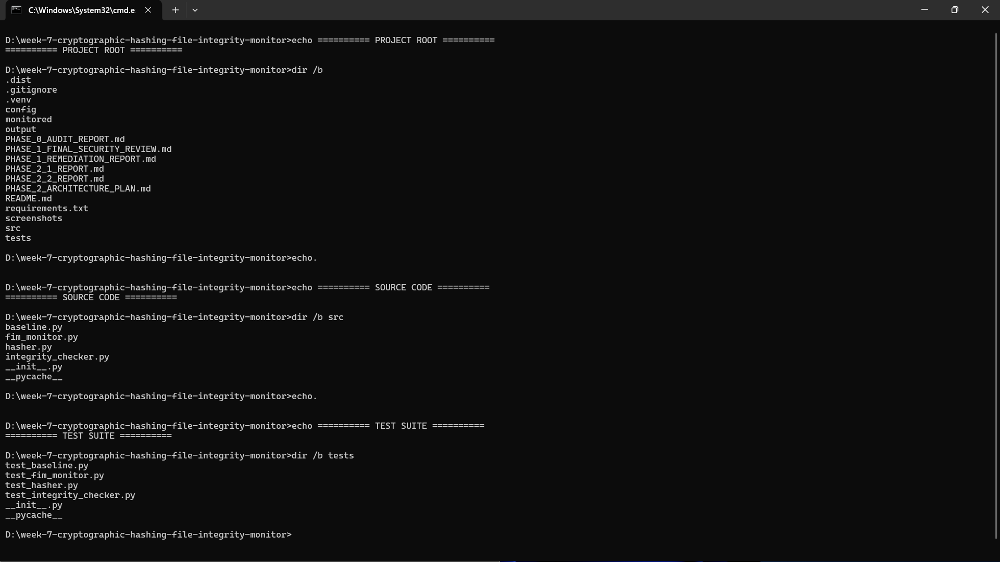
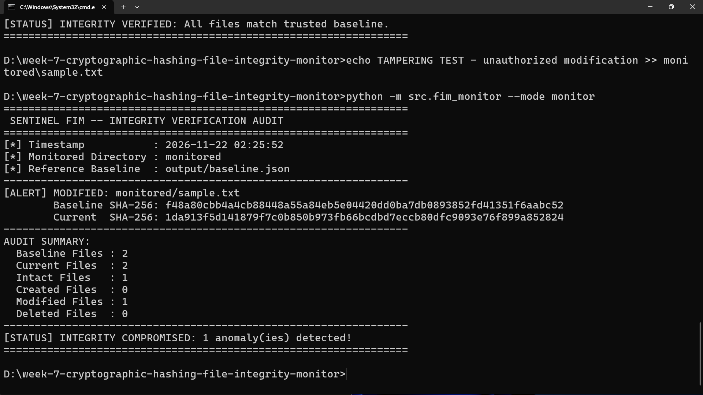

# 🛡️ Week 7 — Sentinel FIM: Cryptographic File Integrity Monitoring

<p align="center">
  
  
  
  
  
</p>

<p align="center">
  <strong>Python-Based Cryptographic Hashing, File Integrity Verification & Tampering Detection</strong>
</p>

<p align="center">
  GetIntern — 8-Week Practical Cybersecurity Internship | Week 7
</p>

---

## 1. Project Overview

**Sentinel FIM (File Integrity Monitor)** is a Python-based defensive cybersecurity tool developed to identify unauthorized changes to files through cryptographic hashing.

The project uses the **SHA-256 cryptographic hash algorithm** to establish a trusted baseline of files and subsequently compare the current filesystem state against that baseline.

By comparing cryptographic digests, Sentinel FIM identifies:

- **Modified Files:** Existing files whose content has changed.
- **Created Files:** New files that were not present in the original baseline.
- **Deleted Files:** Previously recorded files that are no longer present.
- **Intact Files:** Files whose current SHA-256 digest matches the trusted baseline.
- **Scan Errors:** Filesystem inspection failures that prevent a reliable integrity assessment.

The application follows a modular architecture, separating file scanning, baseline management, integrity comparison, and command-line execution.

> **Important:** Sentinel FIM is an on-demand integrity auditing tool. It performs scans when explicitly executed; it is not a continuous background filesystem monitoring service.

## 2. Project Objectives

The primary objectives of this project are:

1. **Understand Cryptographic Hashing:** Learn how SHA-256 generates fixed-length digests for files of different sizes.
2. **Establish File Baselines:** Create and store trusted SHA-256 fingerprints of files in a monitored directory.
3. **Detect Unauthorized Changes:** Identify modified, newly created, and deleted files through baseline comparison.
4. **Implement Secure File Handling:** Use descriptor-bound file inspection and metadata stability checks to reduce filesystem race-condition risks.
5. **Maintain Reliable Baselines:** Apply validation and atomic file replacement when saving baseline records.
6. **Generate Audit Results:** Display integrity findings and use process exit codes to communicate audit outcomes.
7. **Apply Defensive Programming:** Handle filesystem errors, invalid baseline data, and unsupported file conditions safely.

## 3. Key Features

| Feature | Description |
|---|---|
| SHA-256 Hashing | Generates cryptographic fingerprints using SHA-256. |
| Streaming File Processing | Processes files in 1 MiB chunks to keep memory usage bounded. |
| Baseline Generation | Records trusted file paths and SHA-256 digests in JSON format. |
| Integrity Verification | Compares current file hashes against the saved baseline. |
| Tampering Detection | Identifies modified, created, and deleted files. |
| Descriptor-Bound Hashing | Performs hashing through opened file descriptors to reduce TOCTOU risks. |
| File Stability Checks | Detects relevant metadata changes during file inspection. |
| Atomic Baseline Storage | Uses temporary-file writing and atomic replacement. |
| Error Reporting | Surfaces scanning failures instead of reporting an incomplete scan as clean. |
| CLI Interface | Supports baseline generation and integrity verification through command-line arguments. |

## 4. Cryptographic Concepts

### 4.1 What Is Cryptographic Hashing?

Cryptographic hashing is the process of converting input data into a fixed-length output called a hash digest.

A cryptographic hash function accepts data of varying sizes and generates a digest that represents the input.

For file integrity monitoring, this digest acts as a fingerprint of file contents.

If the file content changes, its resulting digest will normally change as well.

### 4.2 Understanding SHA-256

Sentinel FIM uses **SHA-256 (Secure Hash Algorithm 256-bit)**.

SHA-256 is part of the SHA-2 family and is specified in the NIST Secure Hash Standard, FIPS 180-4.

Important properties:

- Produces a 256-bit digest.
- Produces a 64-character hexadecimal representation.
- Processes message data in 512-bit blocks internally.
- Supports files of different sizes.
- Is designed to provide collision resistance and pre-image resistance.

Example:

```text
Input:
Hello World

SHA-256:
a591a6d40bf420404a011733cfb7b190
d62c65bf0bcda32b57b277d9ad9f146e
```

The output is a fixed-length digest regardless of the original input size.

### 4.3 SHA-256 vs. MD5 and SHA-1

| Property | MD5 | SHA-1 | SHA-256 |
|---|---|---|---|
| Digest Size | 128 bits | 160 bits | 256 bits |
| Hex Length | 32 characters | 40 characters | 64 characters |
| Collision Security | Broken | Broken | Currently recommended |
| FIM Suitability | Not recommended | Not recommended | Suitable |

MD5 and SHA-1 are unsuitable for security-sensitive integrity verification because practical collision attacks have been demonstrated.

SHA-256 provides a substantially stronger security margin for this project.

### 4.4 Avalanche Effect

The avalanche effect describes how a small change in input data produces a substantially different hash digest.

For example:

```text
Original File:
Hello World

Modified File:
Hello world
```

Even though only one character changes, the resulting SHA-256 digest will be different.

Sentinel FIM uses this property to detect file-content modifications.

### 4.5 Cryptographic Security Limitations

Cryptographic hashing provides integrity detection, not complete system protection.

Important limitations:

- Hashing does not prevent an attacker from modifying a file.
- SHA-256 does not authenticate the baseline storage location.
- An attacker with sufficient write access to the baseline could potentially replace the recorded hashes.
- A matching content hash does not prove that file permissions, ownership, or access-control settings are unchanged.
- A compromised system may also compromise the integrity-monitoring process.

For stronger protection, baseline storage should be protected through restrictive filesystem permissions, trusted backups, or external integrity verification.

## 5. Environment & Tools

### 5.1 Development Environment

| Component | Technology |
|---|---|
| Programming Language | Python 3.10+ |
| Operating System | Windows / Linux / macOS |
| Cryptographic Algorithm | SHA-256 |
| Data Format | JSON |
| Interface | Command-Line Interface |
| Testing | Python unittest framework |
| Dependency Model | Python Standard Library |

### 5.2 Python Modules Used

| Module | Purpose |
|---|---|
| `hashlib` | SHA-256 digest generation. |
| `os` | File descriptors, filesystem operations, and atomic replacement. |
| `stat` | File metadata inspection. |
| `pathlib` | Filesystem path handling. |
| `json` | Baseline and configuration serialization. |
| `argparse` | Command-line argument parsing. |
| `sys` | Process exit codes and execution support. |
| `datetime` | Audit timestamps. |
| `typing` | Type annotations and structured interfaces. |
| `unittest` | Automated testing. |

**No third-party Python packages are required by the implementation.**

## 6. Project Architecture

Sentinel FIM separates the scanning engine, baseline management, integrity comparison, and command-line orchestration into independent modules.

### 6.1 Repository Structure

```text
week-7-cryptographic-hashing-file-integrity-monitor/
│
├── config/
│   └── fim_config.json
│
├── monitored/
│   ├── documents/
│   │   └── guide.txt
│   └── sample.txt
│
├── output/
│   ├── .gitkeep
│   └── baseline.json
│
├── screenshots/
│   ├── 01-project-structure.png
│   ├── 02-baseline-generation.png
│   ├── 03-clean-integrity-check.png
│   ├── 04-tampering-detection.png
│   ├── 05-restored-integrity.png
│   └── 06-unit-test-results.png
│
├── src/
│   ├── __init__.py
│   ├── hasher.py
│   ├── baseline.py
│   ├── integrity_checker.py
│   └── fim_monitor.py
│
├── tests/
│   ├── __init__.py
│   ├── test_baseline.py
│   ├── test_fim_monitor.py
│   ├── test_hasher.py
│   └── test_integrity_checker.py
│
├── .gitignore
└── README.md
```

*Note: `output/baseline.json` is generated during baseline creation. The structure above describes the intended project layout; generated files may not exist in a fresh checkout.*

### 6.2 Component Responsibilities

**1. `src/hasher.py` — Hashing & Scanning Engine**

The authoritative filesystem scanning and hashing component.

Responsibilities:

- Generates SHA-256 digests.
- Reads files using streaming chunks.
- Uses descriptor-bound file inspection.
- Checks relevant metadata before and after hashing.
- Handles symbolic links and non-regular files defensively.
- Returns structured scan results and errors.

**2. `src/baseline.py` — Baseline Manager**

Responsible for creating, validating, loading, and saving trusted baseline records.

Responsibilities:

- Generates baseline mappings.
- Validates JSON baseline structures.
- Validates SHA-256 digest formats.
- Normalizes file paths.
- Saves baseline records using temporary-file writing and atomic replacement.
- Loads and validates existing baseline data.

**3. `src/integrity_checker.py` — Integrity Checker**

Compares the current filesystem state against the saved baseline.

Responsibilities:

- Identifies intact files.
- Detects modified files.
- Detects newly created files.
- Detects deleted files.
- Collects scanning errors.
- Prevents incomplete scans from being treated as clean.

**4. `src/fim_monitor.py` — CLI Entry Point**

The primary command-line execution interface.

Responsibilities:

- Parses command-line arguments.
- Loads JSON configuration.
- Executes baseline generation.
- Executes integrity verification.
- Displays audit results.
- Returns process exit codes.

### 6.3 System Workflow

```text
                 SENTINEL FIM
                       |
                       v
                CLI ENTRY POINT
                       |
             +---------+---------+
             |                   |
             v                   v
       BASELINE MODE        MONITOR MODE
             |                   |
             v                   v
       BaselineManager     BaselineManager
             |                   |
             v                   v
       Scan Directory       Load Baseline
             |                   |
             v                   v
       SHA-256 Hashing      Scan Directory
             |                   |
             v                   v
       Save JSON Baseline   SHA-256 Hashing
                                 |
                                 v
                         IntegrityChecker
                                 |
                                 v
                        Compare File States
                                 |
                 +---------------+---------------+
                 |               |               |
                 v               v               v
               INTACT          MODIFIED       CREATED
                                 |
                                 v
                              DELETED
                                 |
                                 v
                           AUDIT SUMMARY
                                 |
                                 v
                            EXIT STATUS
```

## 7. Security Safeguards & Design Decisions

Security is an important part of Sentinel FIM's implementation.

### 7.1 Memory-Bounded Streaming

The hashing engine uses a default chunk size of:

```python
DEFAULT_CHUNK_SIZE = 1024 * 1024
```

This represents **1 MiB (1,048,576 bytes)**.

Instead of loading an entire file into memory, the program reads it in smaller chunks and updates the SHA-256 digest incrementally.

Benefits:

- Reduces memory consumption.
- Supports large-file processing.
- Avoids loading complete file contents into memory.

### 7.2 Descriptor-Bound File Inspection

The hashing engine uses low-level file descriptors through `os.open()`.

Where supported, it uses flags such as:

```python
os.O_RDONLY
os.O_NOFOLLOW
```

It also uses `os.fstat()` to inspect the opened file descriptor.

This reduces the risk of certain Time-Of-Check to Time-Of-Use (TOCTOU) race conditions caused by repeatedly resolving a filesystem path.

The exact availability of operating-system flags depends on the platform.

### 7.3 File Stability Verification

File metadata is inspected during the hashing process.

Relevant metadata includes:

- Device identifier.
- Inode identifier.
- File mode.
- File size.
- Modification timestamp in nanoseconds.

If relevant metadata changes during hashing, the operation can be rejected as an unstable file read.

This helps avoid accepting a digest from a file that changed while being inspected.

### 7.4 Symbolic Link Handling

Symbolic links are handled defensively.

The scanner avoids following directory symlinks and rejects unsupported or unsafe file entries rather than treating them as ordinary files.

This reduces the possibility of unintended traversal outside the monitored directory.

### 7.5 Atomic Baseline Persistence

Baseline records are written through a temporary file before being moved into the final destination.

The implementation uses:

- JSON serialization.
- File flushing.
- `os.fsync()`.
- `os.replace()`.

This helps prevent a partially written baseline from replacing the previous baseline during an interrupted save operation.

### 7.6 Scan Error Handling

Filesystem errors must not be silently treated as successful integrity verification.

If the scanner encounters relevant errors, the integrity checker reports them and marks the audit as compromised.

This is important because an incomplete scan cannot reliably establish that all monitored files are intact.

### 7.7 Baseline Storage Isolation

The baseline file is stored separately from the monitored directory:

```text
monitored/
    Files under inspection

output/
    baseline.json
```

This prevents the baseline file from being included in its own monitored scan.

It does not, by itself, protect the baseline from an attacker who has sufficient write permissions.

## 8. Configuration

Sentinel FIM uses a JSON configuration file:

**Location:** `config/fim_config.json`

```json
{
  "algorithm": "sha256",
  "monitored_directory": "monitored",
  "baseline_file": "output/baseline.json"
}
```

### Configuration Parameters

| Parameter | Description |
|---|---|
| `algorithm` | Cryptographic hashing algorithm. The implementation supports SHA-256 only. |
| `monitored_directory` | Directory containing the files to inspect. |
| `baseline_file` | Location used to save or load baseline JSON data. |

Command-line arguments can override the configured monitored directory and baseline file.

## 9. Installation & Setup

### 9.1 Prerequisites

- Python 3.10 or higher.
- Git.
- Windows, Linux, or macOS.
- Basic knowledge of Python and command-line operations.

### 9.2 Clone the Repository

```bash
git clone https://github.com/injmam089/week-7-cryptographic-hashing-file-integrity-monitor.git

cd week-7-cryptographic-hashing-file-integrity-monitor
```

### 9.3 Create a Virtual Environment (Optional)

**Windows:**

```bash
python -m venv .venv

.venv\Scripts\activate
```

**Linux / macOS:**

```bash
python3 -m venv .venv

source .venv/bin/activate
```

### 9.4 Verify Python

```bash
python --version
```

Sentinel FIM uses Python's standard library and does not require third-party package installation.

## 10. Usage Guide

The application supports two primary execution modes:

1. Baseline Generation.
2. Integrity Verification.

General command format:

```bash
python -m src.fim_monitor --mode <baseline|monitor> [OPTIONS]
```

### 10.1 Command-Line Arguments

| Argument | Description |
|---|---|
| `--mode` | Required execution mode: `baseline` or `monitor`. |
| `--dir` | Optional monitored directory path. |
| `--baseline` | Optional baseline JSON path. |
| `--config` | Optional custom configuration file path. |

### 10.2 Baseline Generation

The first step is to create a trusted baseline of the monitored files.

Run:

```bash
python -m src.fim_monitor --mode baseline
```

During baseline generation, the application:

1. Reads the monitored directory.
2. Scans eligible files.
3. Calculates SHA-256 digests.
4. Creates a mapping of relative file paths and their hashes.
5. Validates the generated baseline data.
6. Saves the baseline JSON file.

Expected output pattern:

```text
=================================================================
 SENTINEL FIM -- BASELINE SNAPSHOT GENERATION
=================================================================
[*] Monitored Directory : monitored
[*] Baseline Target     : output/baseline.json
[*] Hash Algorithm      : SHA-256
-----------------------------------------------------------------
[RECORDED] monitored/sample.txt
           Hash: <SHA-256 digest>

[SUCCESS] Baseline successfully established.
[SUCCESS] Saved snapshot to: output/baseline.json
=================================================================
```

*The example illustrates the output format. Actual file paths, timestamps, and digest values depend on the local execution.*

### 10.3 Integrity Verification

After establishing the baseline, run:

```bash
python -m src.fim_monitor --mode monitor
```

The application:

1. Loads the saved baseline.
2. Validates the baseline data.
3. Scans the monitored directory.
4. Calculates current SHA-256 digests.
5. Compares current state against the trusted baseline.
6. Categorizes detected differences.
7. Displays the audit summary.

Possible status messages:

```text
[OK] INTACT: monitored/sample.txt

[ALERT] MODIFIED: monitored/sample.txt

[ALERT] CREATED: monitored/new_file.txt

[ALERT] DELETED: monitored/old_file.txt

[ERROR] SCAN ERROR: <file path>
```

Only the status relevant to the actual audit will be displayed.

### 10.4 Custom Directory

To monitor a different directory:

```bash
python -m src.fim_monitor --mode baseline --dir monitored
```

To use a custom baseline file:

```bash
python -m src.fim_monitor --mode baseline --dir monitored --baseline output/custom_baseline.json
```

To perform verification with the same custom paths:

```bash
python -m src.fim_monitor --mode monitor --dir monitored --baseline output/custom_baseline.json
```

### 10.5 Exit Code Semantics

The CLI uses process exit codes to communicate execution results.

| Exit Code | Meaning |
|---|---|
| `0` | Successful baseline generation or clean integrity verification. |
| `1` | Integrity anomaly, scan failure, or operational error. |

These exit codes can be used by administrative scripts to determine whether an audit completed successfully.

## 11. Tampering Demonstration & Audit Workflow

The following workflow demonstrates how Sentinel FIM can identify file modifications.

### Step 1 — Establish a Trusted Baseline

Run:

```bash
python -m src.fim_monitor --mode baseline
```

The application records the current file hashes.

### Step 2 — Verify Clean Integrity

Run:

```bash
python -m src.fim_monitor --mode monitor
```

If the monitored files have not changed and the scan completes successfully, they should be reported as intact.

### Step 3 — Modify a Monitored File

Modify an existing file, such as:

```text
monitored/sample.txt
```

For example, add or change a line of text.

### Step 4 — Run Integrity Verification Again

```bash
python -m src.fim_monitor --mode monitor
```

The current digest will differ from the recorded baseline digest.

The application should report the affected file as:

```text
[ALERT] MODIFIED: monitored/sample.txt
```

### Step 5 — Restore the Original File

Restore the original file contents.

Run the monitor again:

```bash
python -m src.fim_monitor --mode monitor
```

If the original content is restored and the file matches the baseline, it should be reported as intact.

> **Important:** Restoring the original file content is different from generating a new baseline. Generating a new baseline changes the reference state against which future audits are compared.

## 12. Automated Testing & Verification

Sentinel FIM includes a unit test suite covering the major application components.

### 12.1 Test Modules

| Test File | Testing Scope |
|---|---|
| `test_hasher.py` | SHA-256 hashing, file scanning, streaming, metadata stability, and file handling. |
| `test_baseline.py` | Baseline generation, validation, persistence, and loading. |
| `test_integrity_checker.py` | Integrity comparison, file categorization, and scan-error handling. |
| `test_fim_monitor.py` | CLI arguments, configuration, execution behavior, and exit codes. |

### 12.2 Run the Test Suite

From the project root directory:

```bash
python -m unittest discover -s tests -v
```

### 12.3 Testing Objectives

The automated tests are designed to verify:

- Correct SHA-256 digest generation.
- Correct file scanning behavior.
- Baseline creation and validation.
- Atomic baseline persistence behavior.
- Detection of modified files.
- Detection of created files.
- Detection of deleted files.
- Handling of scan errors.
- Command-line argument processing.
- Correct process exit behavior.

### 12.4 Test Results

Run the test command locally and record the actual result here.

Do not treat an expected test count as a verified result. The final test count and skipped tests should match the latest execution.

## 13. Evidence & Screenshots

The `screenshots/` directory contains visual evidence of the project's implementation and execution.

| Screenshot | Description |
|---|---|
| `01-project-structure.png` | Project directory structure and module organization. |
| `02-baseline-generation.png` | Execution of the baseline generation process. |
| `03-clean-integrity-check.png` | Successful integrity verification without detected changes. |
| `04-tampering-detection.png` | Detection of a modified monitored file. |
| `05-restored-integrity.png` | Integrity verification after restoring the original file content. |
| `06-unit-test-results.png` | Terminal output from automated unit testing. |

### Project Evidence

**1. Project Structure**



**2. Baseline Generation**


**3. Clean Integrity Verification**


**4. Tampering Detection**



**5. Restored Integrity**


**6. Unit Test Results**


## 14. Security Considerations & Limitations

Sentinel FIM is designed for defensive file integrity auditing. However, it has limitations that should be understood before using it in a production environment.

### 14.1 Baseline Protection

The baseline JSON file is a critical trust reference.

If an attacker can modify both the monitored files and the baseline, they may be able to conceal unauthorized changes.

Recommended protections:

- Restrict write permissions on the baseline.
- Store trusted baseline copies separately.
- Use protected backups.
- Consider external or digitally authenticated baseline storage.

### 14.2 On-Demand Monitoring

Sentinel FIM runs when explicitly invoked.

It does not currently provide:

- Continuous background monitoring.
- Kernel-level filesystem event monitoring.
- Automatic real-time alerts.
- Automatic file restoration.
- Automatic firewall configuration.

### 14.3 Filesystem Limitations

Filesystem behavior can differ across operating systems.

File descriptor flags and metadata availability are platform-dependent. The implementation uses defensive checks, but it cannot eliminate every possible filesystem race condition.

### 14.4 Content Integrity vs. System Integrity

SHA-256 verifies file content.

It does not independently verify:

- File ownership.
- File permissions.
- Access-control lists.
- Extended attributes.
- Filesystem configuration.
- The integrity of the operating system itself.

### 14.5 Scan Errors

A failed or incomplete scan must not be interpreted as proof of integrity.

Sentinel FIM surfaces scanning errors so that an administrator can investigate the affected files or directories.

## 15. Current Scope & Future Improvements

### 15.1 Current Implementation

The current implementation focuses on:

- SHA-256-based file fingerprinting.
- Streaming file hashing.
- Trusted baseline generation.
- JSON baseline validation.
- Atomic baseline persistence.
- Differential integrity comparison.
- Modified, created, and deleted file detection.
- Descriptor-bound file inspection.
- Metadata stability checks.
- Symbolic-link handling.
- CLI-based execution.
- Automated unit testing.

### 15.2 Future Improvements

Potential enhancements include:

1. **Continuous Monitoring:** Integrate operating-system filesystem event mechanisms.
2. **Baseline Authentication:** Introduce digitally signed baseline records.
3. **Centralized Reporting:** Send audit results to a centralized logging platform.
4. **Notification System:** Add email or dashboard notifications for detected anomalies.
5. **Metadata Monitoring:** Extend checks to selected file permissions and ownership properties.
6. **Scheduled Audits:** Support automated periodic integrity verification.
7. **Enhanced Reporting:** Generate structured HTML or PDF audit reports.

These are proposed improvements, not claims about existing functionality.

## 16. Security Concepts Learned

Through this project, the following cybersecurity concepts were explored:

- Cryptographic hashing and SHA-256.
- File integrity monitoring.
- Baseline generation and comparison.
- Cryptographic collision resistance.
- Pre-image and second pre-image resistance.
- Avalanche effect.
- File-system security.
- Time-Of-Check to Time-Of-Use (TOCTOU) risks.
- Descriptor-bound file operations.
- Symbolic-link security.
- Atomic file operations.
- Defensive error handling.
- Security testing and verification.

## 17. Learning Outcomes

This project provided practical experience in developing a modular defensive cybersecurity application.

Key learning outcomes:

- Understanding how cryptographic hashes support file integrity verification.
- Implementing SHA-256 hashing using Python.
- Processing files through memory-bounded streaming.
- Creating and validating JSON-based baselines.
- Detecting unauthorized file modifications.
- Applying defensive filesystem handling.
- Structuring a Python security tool into reusable modules.
- Testing security-related functionality using automated unit tests.
- Interpreting integrity audit results.

## 18. Conclusion

**Sentinel FIM** demonstrates how cryptographic hashing can be applied to defensive cybersecurity and file integrity monitoring.

By establishing trusted SHA-256 baselines and comparing them against current filesystem states, the application can identify modified, created, and deleted files.

The project also emphasizes secure implementation practices, including streaming file processing, descriptor-bound inspection, metadata stability checks, atomic baseline persistence, and explicit scan-error handling.

Sentinel FIM provides a practical foundation for understanding file integrity monitoring and the role of cryptographic verification in system security.

---

## 19. Author

**Injmam Ansari**

BCA Student | Cybersecurity & Software Development

- GitHub: [@injmam089](https://github.com/injmam089)
- Project Repository: [Sentinel FIM — Week 7](https://github.com/injmam089/week-7-cryptographic-hashing-file-integrity-monitor)

---

## 20. Internship Context

**GetIntern — 8-Week Practical Cybersecurity Internship**

**Week 7:** Cryptographic Hashing & File Integrity Monitoring

This project was developed as part of practical cybersecurity learning, focusing on cryptographic verification, defensive filesystem analysis, and integrity monitoring.

---

<p align="center">
  <strong>Built with Python | Focused on Defensive Cybersecurity</strong>
</p>

<p align="center">
  <sub>For educational and authorized defensive security purposes only.</sub>
</p>
